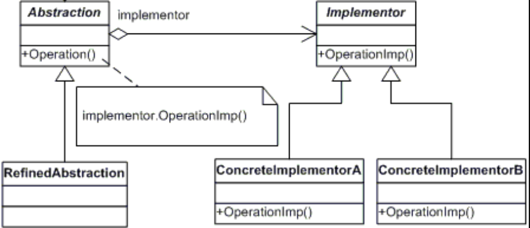

# Мост (Bridge)

## 1. Категория. 
Структурный паттерн проектирования.

## 2. Когда используется.
Мост разделяет класс на две независимые иерархии: абстракцию (управляющий слой) и реализацию (слой, который выполняет делегированную работу).

Применяется, когда:
- класс нужно расширять сразу в двух независимых направлениях, и число подклассов растёт как произведение;
- монолитный класс содержит несколько вариантов реализации одной функциональности;
- реализацию нужно менять во время работы программы.

## 3. Ошибки при использовании.
- Применять Мост, когда есть только одно измерение изменений: это лишнее усложнение.
- Делать интерфейс реализации слишком «толстым» или копирующим интерфейс абстракции: разделение теряет смысл.
- Создавать конкретную реализацию внутри абстракции: они жёстко связываются. Реализацию нужно передавать через конструктор.
- Путать со Стратегией: структура похожа, но цель Моста структурная (две иерархии), а Стратегии поведенческая (замена алгоритма).
- Путать с Адаптером: Адаптер подгоняет уже существующие несовместимые классы, а Мост закладывается на этапе проектирования.
- Путать «абстракцию» и «реализацию» из паттерна с абстрактными классами и интерфейсами языка.

## 4. Схема.



**Участники:**
- `Abstraction`: управляющая логика, хранит ссылку на Implementor и делегирует ему работу.
- `RefinedAbstraction`: вариации управляющей логики.
- `Implementor`: общий интерфейс всех реализаций.
- `ConcreteImplementor`: конкретная, платформо-зависимая реализация.
- `Client`: работает только с Abstraction, реализацию подаёт в конструктор.

## 5. Формулировка задачи
В условиях нестабильного рынка наблюдается устойчивая категория граждан, классифицируемая как «инвесторы»: терпилы (прогнувшиеся под систему), темщики и скамеры. Каждый из них периодически испытывает потребность в финансировании и сопровождает её отговоркой безденежья: увольнение (они ушли сами), несвоевременное вложение в криптоактивы, а также состояние «не вайбик». 

Требуется спроектировать систему, в которой тип инвестора и отговорка развиваются независимо: новая отговорка не требует менять классы инвесторов, а новый тип инвестора не требует менять отговорки.

## 6. Решение задачи

Две независимые иерархии: `инвесторы` (абстракция) и `отговорки` (реализация). Инвестор хранит ссылку на отговорку и делегирует ей объяснение. Наследованием вышло бы 3 × 3 = 9 классов, с Мостом получается 3 + 3 = 6.

```python
# Реализация (Implementor): отговорки
class Excuse:
    def explain(self): ...

# Конкретные реализации (ConcreteImplementor)
class QuitExcuse(Excuse):
    def explain(self): return "ссылается на увольнение; в трудовой указано — 'по собственному'"

class CryptoExcuse(Excuse):
    def explain(self): return "не успел зайти в крипту вовремя"

class NotVibeExcuse(Excuse):
    def explain(self): return "сегодня не вайбик"
# Новая отговорка = новый подкласс Excuse


# Абстракция (Abstraction): инвесторы
class Investor: 
    def __init__(self, excuse: Excuse):
        self.excuse = excuse  # МОСТ: ссылка на реализацию, передаётся через конструктор

    def ask_money(self):
        print(f"{self.title}: запрос средств. Основание: {self.excuse.explain()}.")

# Уточнённые абстракции (RefinedAbstraction): у каждого своё поведение
class Terpila(Investor):
    title = "Терпила"
    def ask_money(self):
        super().ask_money()
        print("Субъект утверждает, что система его прогнула. Система не в курсе.")

class Temshchik(Investor):
    title = "Темщик"
    def ask_money(self):
        super().ask_money()
        print("Ожидаемая доходность: ×10. Возврат: не предусмотрен регламентом.")

class Scammer(Investor):
    title = "Скамер"
    def ask_money(self):
        super().ask_money()
        print("Реквизиты направлены. Обратная связь не планируется.")
# Новый инвестор = новый подкласс Investor


# Клиентский код
Terpila(QuitExcuse()).ask_money()
print()
Scammer(CryptoExcuse()).ask_money()
print()

t = Temshchik(NotVibeExcuse())
t.ask_money()
print()
t.excuse = QuitExcuse()  # смена реализации (отговорки) во время работы программы
t.ask_money()

print("\nВывод: все субъекты нуждаются в финансировании. Финансирование не рекомендовано.")
```

