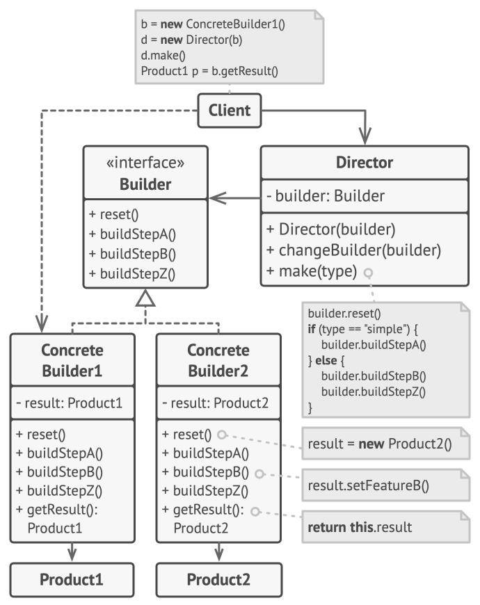

# Паттерн «Строитель» (Builder)

## 1. Категория шаблона

Строитель — это **порождающий** шаблон проектирования, который позволяет создавать сложные объекты пошагово. В отличие от других порождающих паттернов, Строитель не требует наличия единого интерфейса для всех создаваемых объектов. Он дает возможность использовать один и тот же код для создания различных представлений объектов.

## 2. Когда используется

Шаблон Строитель применяется в следующих ситуациях:

* Когда процесс создания объекта является сложным и состоит из множества шагов.
* Когда необходимо избавиться от «телескопических конструкторов» (конструкторов с огромным количеством необязательных параметров).
* Когда нужно создавать различные представления одного и того же объекта (например, машина может быть собрана в разных комплектациях: «базовая» и «люкс»).
* Когда нужно изолировать сложный код сборки объекта от его основной бизнес-логики.

**Важно:** если объект имеет простую структуру и мало параметров, применение Строителя будет излишним усложнением кода.

## 3. Ошибки при использовании

* **Использование для простых объектов.** Если у класса всего 2-3 поля, обычный конструктор справится быстрее и проще.
* **Дублирование кода в Директоре.** Директор должен только управлять порядком вызовов, а не знать внутреннее устройство конкретных строителей.
* **Отсутствие метода `reset()`.** Если один и тот же объект Строителя используется многократно для создания разных продуктов, он должен уметь сбрасывать свое внутреннее состояние перед новой сборкой.
* **Путать с паттерном «Абстрактная фабрика».** Фабрика создает семейства связанных объектов за один шаг, а Строитель собирает один сложный объект пошагово.

## 4. Схема

### Участники:

* **Builder (Интерфейс строителя):** объявляет шаги конструирования продукта, общие для всех видов строителей.
* **ConcreteBuilder (Конкретные строители):** реализуют шаги конструирования, каждый по-своему. Могут производить разнородные объекты, не имеющие общего интерфейса. Хранят результат сборки.
* **Director (Директор):** определяет порядок вызова строительных шагов для производства той или иной конфигурации продуктов. Не знает о конкретных классах строителей, работает через интерфейс `Builder`.
* **Product (Продукт):** создаваемый сложный объект.
* **Client (Клиент):** подает директору уже готовый объект-строитель, и в дальнейшем директор использует только его. В результате клиент получает готовый продукт из строителя (метод `getResult()`).
