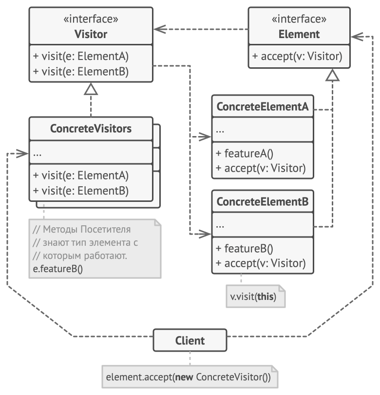

# Паттерн «Посетитель» (Visitor)

## 1. Категория шаблона

**Посетитель** — это **поведенческий** шаблон проектирования, который позволяет добавить новую операцию для целой иерархии классов, не изменяя код этих классов. Он описывает способ организации взаимодействия между объектами, позволяя добавлять новые операции над элементами некоторой структуры без изменения самих классов этих элементов.

## 2. Когда используется

Шаблон Посетитель применяется в следующих ситуациях:

- Когда есть **стабильная иерархия классов** (классы элементов редко меняются), но над объектами нужно выполнять много разных операций.
- Когда не хочется «засорять» классы элементов методами, не относящимися к их основной задаче.
- Когда операция зависит от **конкретного типа** элемента, а клиентский код не должен использовать `isinstance(...)` для выбора действия.
- Когда нужно обойти составную структуру (дерево, список) и применить к каждому элементу нужную операцию.

**Важно:** если иерархия классов элементов часто меняется — Посетитель не подходит. Каждый новый тип элемента потребует правки всех посетителей.

## 3. Ошибки при использовании

- **Применение к нестабильной иерархии.** Если классы элементов продолжают добавляться, паттерн только усложняет код: каждый новый элемент требует нового метода во всех посетителях.
- **Подмена обычного полиморфизма.** Если операция логически принадлежит самому элементу (например, `circle.area()`), выносить её в посетитель не нужно — это лишнее усложнение.
- **Забытая двойная диспетчеризация.** В Python легко ошибиться и написать `visit(self, element)` с проверками типов внутри, вместо того чтобы из метода `accept` каждого элемента вызывать свой метод посетителя (`visitor.visit_circle(self)`). Тогда теряется главное преимущество паттерна.
- **Состояние в посетителе при рекурсии.** Если посетитель накапливает результат (например, сумму) и применяется повторно к вложенным структурам, можно получить неверный результат.

## 4. Схема

**Главная идея:** каждый элемент в методе `accept(visitor)` вызывает **свой** метод посетителя и передаёт ему `self`. Получается **двойная диспетчеризация**: выбор операции зависит и от типа посетителя, и от типа элемента.
